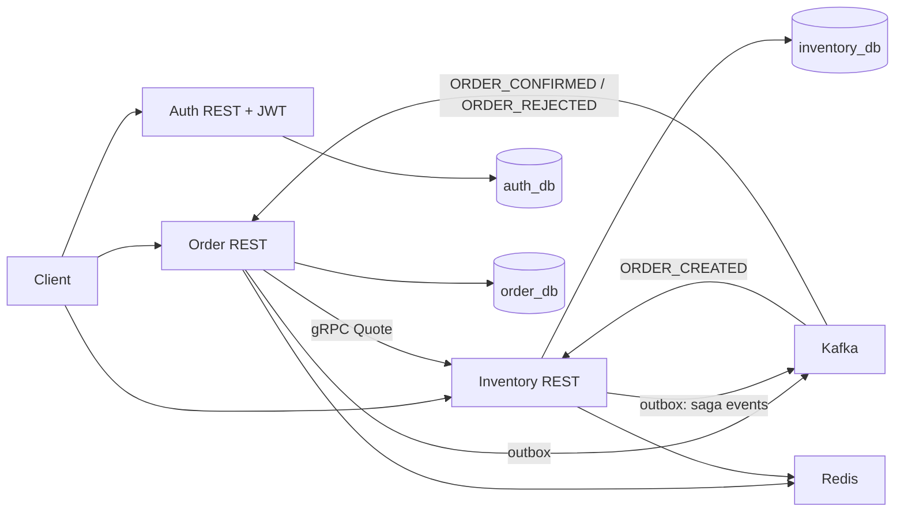

# Архитектура и DDD

## Предметная область

Система моделирует оформление покупки в онлайн-магазине: пользователь регистрируется, просматривает каталог, собирает корзину, оформляет заказ, резервирует товары и оплачивает их из внутреннего кошелька. Данные заказа и склада принадлежат разным сервисам, поэтому единая ACID-транзакция между ними отсутствует. Завершение бизнес-процесса обеспечивает сага.

## Ограниченные контексты и 10 агрегатов

**Identity — auth-service.** User — корень учётной записи: UUID, нормализованный уникальный email, BCrypt hash, роль, признак active. CustomerProfile — отдельный корень данных покупателя: имя, адрес и телефон; ID совпадает с UUID пользователя, профиль изменяется независимо от пароля.

**Sales — order-service.** Order — заказ со своей идентичностью, владельцем, статусом и временем создания. Он владеет OrderItem; позиция не является отдельным агрегатом. Cart — отдельная изменяемая корзина пользователя со списком productId/quantity. Coupon — самостоятельное правило скидки, идентифицируемое UUID, с кодом и процентом 1–50; endpoint quote демонстрирует расчёт скидки. Купон не применяется автоматически к оплате заказа.

**Inventory — inventory-service.** Product — товар, текущая цена и доступное количество. Category — самостоятельный справочник категорий с UUID и названием; в учебной модели связь категории с товаром не обязательна. Reservation — корень резерва под заказ с состояниями ACTIVE, CONFIRMED, RELEASED. Wallet — баланс покупателя в одной валюте. Payment — факт списания, уникальный по заказу.

Итого: 2 + 3 + 5 = 10 агрегатов. OrderItem — entity внутри Order, Money — value object. Inbox, outbox и order_sagas — технические записи процесса, они не увеличивают число бизнес-агрегатов.

## Границы и зависимости

Identity владеет auth_db, Sales — order_db, Inventory — inventory_db. Сервисы не читают чужие таблицы и не создают межбазовые FK. Между контекстами передаются UUID и контрактные сообщения.

Каждый сервис состоит из трёх сборочных частей. `:service:domain` компилирует доменную модель, не зависит от Spring и адаптеров. `:service:application` содержит use cases, зависит от domain, портов и contracts; Spring-аннотации управляют транзакциями и кешированием. Исполняемый `:service` содержит presentation/infrastructure, зависит от двух внутренних модулей и подставляет реализации портов через constructor injection.

Исходники расположены в src/main/java по пакетам, а build.gradle.kts внутренних модулей выбирает соответствующие каталоги через sourceSets. Исполняемый модуль исключает эти пакеты из своей компиляции. Поэтому случайный import infrastructure в application приводит к ошибке сборки. `contracts` — библиотека формата StoreEvent, JSON codec и gRPC MethodDescriptor; отдельного запуска не требует.

## Порты

Auth: UserRepository отделяет use case от JPA, TokenIssuer отделяет выдачу токена от JWT-библиотеки, DocumentStore отделяет профиль от SQL. Order: OrderRepository, OrderEvents, CatalogPort, SagaResultStore и DocumentStore. Inventory: ProductRepository, SagaStore, WalletStore и DocumentStore. Реализации расположены в infrastructure.

## Архитектурные решения

Склад и внутренний биллинг объединены в один ограниченный контекст для компактного стенда. Резерв и списание выполняются в разных локальных транзакциях через Kafka. Распределённость проявляется между order_db и inventory_db; координатор в памяти отсутствует.

JSON-хранилище documents используется для небольших самостоятельных агрегатов: профиль, корзина, купон, категория. Логический тип kind и владелец входят в выборку; доменные модели проверяют содержимое до сохранения. Основные финансовые и складские данные хранятся в отдельных реляционных таблицах с ограничениями.

Это демонстрационный стенд: создание товаров, категорий и пополнение учебного кошелька разрешены зарегистрированным пользователям. Доступ к заказам и личным документам ограничен владельцем. Для промышленной эксплуатации нужны отдельные права администрирования, версионируемые миграции, наблюдаемость, лимиты запросов и защищённый транспорт между узлами.
