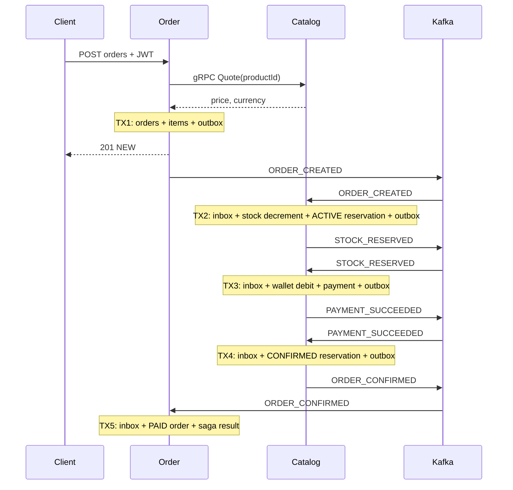

# Распределённая транзакция, outbox и inbox

## Почему нельзя использовать одну транзакцию

Заказ хранится в order_db, товар и кошелёк — в inventory_db. @Transactional обеспечивает атомарность только внутри одной базы своего сервиса. Kafka не входит в обычную JDBC-транзакцию. Поэтому бизнес-операция покупки разбита на последовательность локальных транзакций, а результаты передаются событиями.

Выбрана **хореография**: участники реагируют на события, центрального оркестратора нет. InventorySaga — обработчик шагов своего контекста, а не распределённый координатор с синхронными командами.

## Успешный сценарий

## Отказ резерва

PostgresSagaStore.reserve сначала блокирует и проверяет все товары. Если одного не хватает, UPDATE количества не выполняется. Outbox получает ORDER_REJECTED с reason=Insufficient stock. Заказ переходит NEW → CANCELLED. Компенсировать нечего, так как резерв не создан.

## Отказ оплаты и компенсация

После STOCK_RESERVED уже существует отдельный закоммиченный резерв ACTIVE и уменьшено доступное количество. В следующей транзакции UPDATE кошелька не находит достаточного баланса либо нужной валюты. Появляется PAYMENT_FAILED. Отдельная обработка этого события переводит резерв ACTIVE → RELEASED, возвращает товары и публикует ORDER_REJECTED. Заказ становится CANCELLED. Это бизнес-компенсация ранее завершённой транзакции резервирования, а не rollback общего распределённого соединения.

## Формат события

StoreEvent содержит eventId UUID, type, orderId, customerId, amount, currency, items[{productId,quantity}], reason. Метод next создаёт новый eventId, сохраняя бизнес-корреляцию orderId. eventId нужен для дедупликации конкретной доставки; orderId связывает шаги одной покупки. Kafka key=orderId. Топики store.order.v1 и store.inventory.v1 разделены по источнику сообщений. Суффикс v1 отделяет контракт от прежних демонстрационных сообщений.

## Transactional outbox

Создание бизнес-данных и исходящего сообщения происходит в одной БД-транзакции. Если commit не состоялся, нет ни бизнес-операции, ни сообщения. Publisher читает только сохранённые записи, отправляет Kafka и ждёт ack. Только затем выставляет SENT/sent=true.

Сбой после публикации до commit признака SENT может привести к повторной отправке. Гарантия доставки — **at least once**. Exactly once для всей системы не заявляется. Kafka producer enable.idempotence защищает часть повторов на уровне протокола, но не заменяет inbox.

Order publisher использует PESSIMISTIC_WRITE. Inventory publisher использует FOR UPDATE SKIP LOCKED, поэтому параллельные экземпляры не берут одну строку одновременно. Ошибка ack оставляет или восстанавливает запись для повтора. Kafka producer acks=all в данном стенде означает подтверждение единственного брокера: отказоустойчивого Kafka-кластера здесь нет.

## Transactional inbox

Каждый consumer вставляет eventId в свою inbox-таблицу. PK и ON CONFLICT DO NOTHING превращают повтор в no-op. Inbox находится в той же локальной транзакции, что изменение склада/кошелька/заказа и новый outbox. Если бизнес-операция падает, inbox также откатывается, и повтор может снова выполнить шаг.

Оплата дополнительно защищена PK payments.order_id. Компенсация изменяет только ACTIVE резерв и возвращает товар только при успешном изменении одной строки. Остатки блокируются FOR UPDATE, кошелёк списывается условным атомарным UPDATE.

DefaultErrorHandler настроен на повторы с паузой 2 секунды без автоматического пропуска ошибочного сообщения. Это обеспечивает повтор при временном сбое, но повреждённое сообщение может остановить соответствующую партицию до вмешательства. Для промышленной системы стоит добавить DLQ и процедуру восстановления.

## Ограничения и проверка

Сага не имеет общего таймаута или автоматической отмены зависшего процесса. При временной недоступности участника заказ остаётся NEW до восстановления и обработки событий. Платёжный провайдер внешний не вызывается. Компенсация показана на отказе внутреннего кошелька. Технические события и inbox не очищаются автоматически.

scripts/integration.py проверяет успех, отказ по остатку, недостаток денег с возвратом товара, повтор исходного eventId и конкуренцию за последнюю единицу. Unit-тесты InventorySagaTest проверяют выбор компенсирующего действия отдельно от инфраструктуры.
